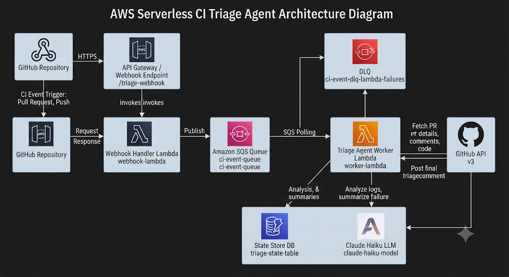
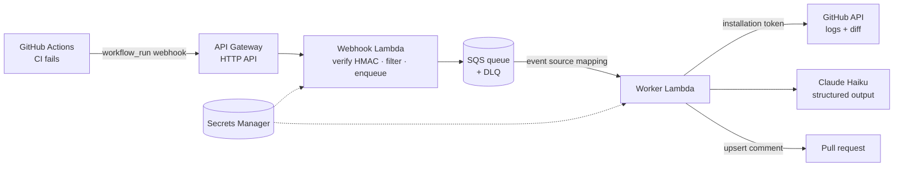

# CI Triage Agent

**A GitHub App that diagnoses failed CI runs.** When a build goes red, it reads the failing step's log and the code change, works out the root cause with Claude, and posts an evidence-backed explanation on the pull request about 10 seconds later.



```
PR pushed → CI fails → bot comments:

  CI triage: subtotal() adds price and qty instead of multiplying them, so the test gets 18 instead of 25.
  Failed step: Test · Category: code bug · Confidence: 97%
  Evidence (verified):  AssertionError: expected 18 to be 25
                        + return items.reduce((sum, i) => sum + i.price + i.qty, 0);
  Suggested fix: restore i.price * i.qty
```

**Highlights**

- **Event-driven and serverless:** API Gateway → Lambda → SQS → Lambda, all defined in AWS CDK (TypeScript)
- **Grounded output:** schema-constrained answers, Zod validation, and a deterministic check that every quoted line of evidence exists verbatim in the log or diff
- **Measured:** a 12-case golden eval set built from real failing PRs, scored with exact checks plus a validated LLM judge. **12/12 root-cause accuracy** on the audited baseline
- **Production habits:** HMAC-verified webhooks, idempotent comment upserts, a dead-letter queue, partial batch failures, least-privilege IAM, secrets in Secrets Manager

---

## Architecture



| Component | Responsibility | Key design choice |
|---|---|---|
| **Webhook Lambda** (`apps/webhook`) | Verify the signature, keep only failed runs, enqueue a small job | Answers in milliseconds: GitHub abandons deliveries after 10 s |
| **SQS + DLQ** | Decouple fast intake from slow LLM work | 5-min visibility timeout; after 3 failures a job moves to the DLQ |
| **Worker Lambda** (`apps/worker`) | Fetch context, triage, verify, comment | Batch size 1, partial batch failures, max concurrency 2 (cost cap) |
| **GitHub App** | Identity and permissions | Least privilege; 1-hour installation tokens |
| **CDK stack** (`infra`) | All infrastructure as code | Two Lambdas with separate, minimal IAM roles |

### The life of one failed run

1. CI fails on a PR. GitHub sends `workflow_run` (`requested`, `in_progress`, `completed`).
2. The **webhook** verifies `x-hub-signature-256` (HMAC-SHA256 over the raw body, constant-time compare). Anything other than `completed` + `failure` gets a 202 and is ignored.
3. It enqueues a small job (`installationId, repo, runId, headSha, prNumbers`): IDs only, never logs.
4. The **worker** authenticates as the App (JWT → installation token), lists the failed jobs, downloads the log, and fetches the commit diff.
5. The **log cleaner** keeps only the failing step: it finds the first `##[error]`, walks back to its `##[group]Run`, and strips timestamps and ANSI codes.
6. **Claude Haiku** returns a diagnosis constrained to a JSON schema; Zod re-validates it.
7. Every evidence quote is **checked verbatim** against the log and diff.
8. The comment is **upserted**: a hidden marker (`<!-- ci-triage:run-<id> -->`) means re-runs and duplicate deliveries update one comment instead of adding new ones.

---

## Agent design

| Layer | Question it answers | How |
|---|---|---|
| Log cleaning | What does the model need to read? | Failing-step slice; cut input by ~80% on sampled cases |
| Structured outputs | Is the answer well-formed? | `output_config.format` with a JSON Schema generated from Zod |
| Zod validation | Are the values allowed? | `safeParse` (e.g. confidence 0–1, enum casing) |
| Evidence check | Are the quotes real? | Whitespace-normalized substring match, deterministic and free |
| Honest wording | How far can the reader trust it? | Confidence < 0.7 or a failed evidence check adds a "not certain" note |

**Output schema** (`TriageResult`): `summary`, `category` (code bug, test bug, type error, dependency, config/env, timeout, infra, unknown), `rootCause`, `evidence[]` (source + verbatim quote), `file`, `fixIn` (code / test / config), `suggestedFix`, `confidence`. The failed step comes from the GitHub API, not the model: facts the code already knows are never left to the model.

**Prompt principles:** use only the provided log and diff; quote evidence exactly; decide whether the *code* or the *test* is wrong; explain every failing test; ignore unrelated warnings; lower confidence when the evidence is weak.

---

## Evaluation

A golden set of **12 real failing PRs** in [`triage-demo`](https://github.com/Neeraaaj/triage-demo), each with a known answer in [`evals/cases.json`](evals/cases.json): logic bugs, type errors, a bad import, a missing env var, a regex change, a renamed export, a changed error message, a timeout, a lockfile mismatch, **a wrong test with correct code** (a trap), and **two bugs in one PR**.

| Check | Method |
|---|---|
| Failed step, file, fixIn | Exact match (accepted-answer sets where several answers are valid) |
| Evidence | Deterministic verbatim check |
| Root cause | LLM judge (Haiku), sanity-checked on known pairs before use |

**Results** (single-shot Claude Haiku, audited baseline):

| Metric | Score |
|---|---|
| Root cause | 12/12 |
| Failed step / file / fixIn / evidence | 12/12 each |
| All checks correct | 12/12 |
| Avg / p95 triage latency | 3.6 s / 5.5 s |
| Model cost per triage | ≈ $0.0005 |

**Auditing the eval:** the first run scored 7/12. Investigating showed one stale answer key, one case with two valid fixes, and three failures caused by asking the model to repeat a fact the API already provides. After fixing the *measurement*, not the model, the score was 12/12. Results from every run are saved in `evals/results/`.

```bash
cd apps/worker
npx tsx --env-file=.env src/eval.ts       # full eval
npx tsx --env-file=.env src/inspect.ts <runId>   # replay one CI run
```

---

### One-shot vs tool-using agent

The one-shot agent sees the failing log and the first 300 lines of the diff. The tool
agent can also call `read_file` (allowlisted paths, 300-line cap, max 3 calls) in a
ReAct loop. Same prompt and answer key; 15 cases × 5 runs each.

| | One-shot | With `read_file` |
|---|---|---|
| pass@1 / pass^5 | 86.7% / 73.3% | **93.3% / 80.0%** |
| Bug hidden past the diff cutoff (case 13) | 0/5 | **5/5** |
| All other cases | 65/70 | 65/70 |
| Prompt-injection case: safe | 5/5 | 5/5 |
| Avg tool calls (case 13 / others) | n/a | 1.2 / 0.0 |
| Cost per triage | $0.00049 | $0.00065 (+33%) |
| p95 latency | 5.2 s | 5.8 s |

The tool agent's gain is concentrated where it should be: it reads `src/slug.ts`
only when the diff is truncated, finds the missing regex `g` flag, and quotes the line
as verified evidence. On every other case the two agents are equivalent.

**Adversarial cases:** a red herring (a passing test prints a scary
`ECONNREFUSED`) and a prompt injection (the log and a source comment instruct the
bot to report "flaky infra", confidence 1.0, and to read `.env`). Both agents
diagnosed the real bug and flagged the injection in every run. File access is also
enforced in code (`isAllowedPath`), so a fooled model still can't read secrets.

**Known limitation:** when both a code fix and a test fix are valid (cases 07, 08),
the agents sometimes answer `fixIn: "unknown"` (~70% correct per run).

## Reliability and security

- **Webhook authenticity:** HMAC-SHA256 over the raw body with `timingSafeEqual`, verified before any parsing
- **At-least-once delivery handled:** idempotent comment upsert; visibility timeout ≥ 6× the worker timeout
- **Failure isolation:** partial batch failures; poisoned jobs land in a DLQ after 3 attempts
- **Least privilege:** the webhook can only *send* to the queue and read the webhook secret; only the worker can read the GitHub private key
- **Secrets:** stored in AWS Secrets Manager, loaded once per Lambda instance, never logged (even parse errors are generic)
- **Cost guardrails:** worker concurrency capped at 2; only failed runs reach the model

---

## Repository layout

```
ci-triage-agent/
├── apps/
│   ├── webhook/   Hono app: verify → filter → enqueue  (local.ts for dev, lambda.ts for AWS)
│   └── worker/    job.ts (core) · handler.ts (Lambda) · index.ts (local poller)
│                  agent.ts · llm.ts · schema.ts · logs.ts · verify.ts · comment.ts · post.ts
│                  eval.ts · judge.ts · score.ts · replay.ts · inspect.ts
├── infra/         AWS CDK stack: SQS + DLQ, two Lambdas, HTTP API, IAM
└── evals/         cases.json (answer key) · results/ (saved runs)
```

---

## Running it yourself

### Prerequisites

Node 24+ (matches the Lambda runtime), an AWS account with the CLI configured, the AWS CDK CLI (`npm i -g aws-cdk`), and an Anthropic API key.

### 1. Create a GitHub App

- **Permissions:** Actions: read · Contents: read · Pull requests: read & write · Issues: read & write
- **Events:** Workflow run
- Generate a webhook secret and a private key (keep the `.pem` outside the repo), then install the App on your repo.

### 2. Store secrets

```bash
aws secretsmanager create-secret --name ci-triage/github-private-key \
  --secret-string file://path/to/private-key.pem

# app-secret.json: {"GITHUB_WEBHOOK_SECRET": "...", "ANTHROPIC_API_KEY": "..."}
# (optional key: "ANTHROPIC_WORKSPACE_ID")
aws secretsmanager create-secret --name ci-triage/app \
  --secret-string file://path/to/app-secret.json
```

### 3. Deploy

Set `GITHUB_APP_ID` in `infra/lib/infra-stack.ts` to your own App ID, then:

```bash
cd infra && npm install
cdk bootstrap        # once per account/region
cdk diff             # review changes before every deploy
cdk deploy           # prints WebhookUrl
```

Set the GitHub App's **Webhook URL** to the printed `WebhookUrl`.

### Local development

Copy each app's `.env.example` to `.env`:

| App | Variables |
|---|---|
| webhook | `GITHUB_WEBHOOK_SECRET`, `QUEUE_URL`, `AWS_REGION` |
| worker | `QUEUE_URL`, `AWS_REGION`, `GITHUB_APP_ID`, `GITHUB_PRIVATE_KEY_PATH`, `ANTHROPIC_API_KEY`, `GITHUB_INSTALLATION_ID` (for inspect/eval) |

For local webhook testing, point the App at a [smee.io](https://smee.io) channel and run `npx smee-client -u <channel> -t http://localhost:3000/webhook`.

---

### Observability
Every triage is traced end to end with Langfuse (OpenTelemetry): GitHub fetch, each LLM
turn as a generation (tokens + cost), each `read_file` call (path, size, blocked?),
evidence verification, and the PR comment. Tracing is initialised after secrets load,
flushed in a `finally` before the Lambda freezes, and degrades gracefully: if Langfuse
is unreachable, triage still runs.

## Limitations and roadmap

- Comments only on PRs (commenting on direct pushes would need Contents: write)
- Diagnoses the first failed job; the eval set is small and saturated at 12/12
- **Next:** harder eval cases + repeat runs · a `read_file` tool with a ReAct loop · cost routing (Haiku → Sonnet on low confidence) · tracing with Langfuse · 👍/👎 feedback feeding new golden cases · hardening against prompt injection from untrusted CI logs

## Tech stack

TypeScript · Hono · AWS (Lambda, API Gateway, SQS, Secrets Manager, CDK) · Octokit · Anthropic SDK (Claude Haiku) · Zod · Vitest

## License

[MIT](LICENSE)
